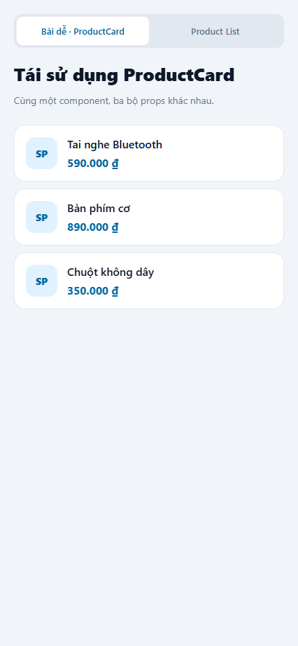
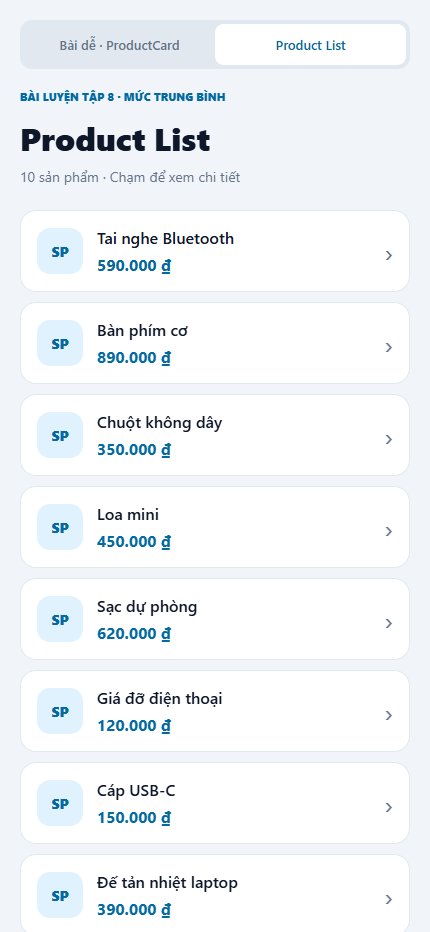
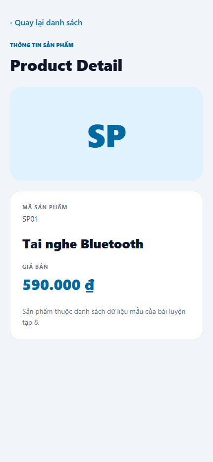

# B. Bài tập luyện tập thực hành

## 1. Mức dễ — ProductCard

Component [ProductCard](./components/ProductCard.js) nằm trong file riêng và được `export default`. Component cha [App](./App.js) import và sử dụng ba lần:

```jsx
<ProductCard name="Tai nghe Bluetooth" price={590000} />
<ProductCard name="Bàn phím cơ" price={890000} />
<ProductCard name="Chuột không dây" price={350000} />
```

Cha truyền tên và giá qua hai props `name`, `price`. Con destructure các props để hiển thị bằng `Text`, dùng `formatPrice` định dạng số theo Việt Nam kèm ký hiệu đồng. Giá được truyền dưới dạng number qua `{...}`, không phải chuỗi đã định dạng. `ProductCard` không thay đổi props và không lưu bản sao vào state. Cùng một bố cục có thể hiển thị nhiều sản phẩm khác nhau nên component tái sử dụng được.

Component còn nhận callback tùy chọn `onPress`: ở bài dễ nó là thẻ hiển thị; ở danh sách nó là thẻ có thể bấm để xem chi tiết.



## 2. Mức trung bình — Product List và Detail

[products.js](./data/products.js) chứa **10 sản phẩm**, mỗi phần tử gồm `id`, `name`, `price`. [ProductListScreen](./screens/ProductListScreen.js) dùng `FlatList`, `keyExtractor` lấy `id` duy nhất, và `renderItem` tái sử dụng `ProductCard`.

Khi bấm một item, danh sách gọi callback do App truyền vào:

```jsx
onPress={() => onSelectProduct({
  id: item.id,
  name: item.name,
  price: item.price,
})}
```

App lưu sản phẩm vào `selectedProduct` bằng `useState`, sau đó render màn chi tiết:

```jsx
<ProductDetailScreen
  {...selectedProduct}
  onBack={() => setSelectedProduct(null)}
/>
```

[ProductDetailScreen](./screens/ProductDetailScreen.js) nhận trực tiếp ba props `id`, `name`, `price` và hiển thị đúng sản phẩm được chọn. Callback `onBack` xóa lựa chọn để quay về danh sách. Effect trong App đăng ký nút Back Android và gỡ listener khi effect được dọn dẹp. Danh sách không bị lồng trong `ScrollView` để giữ cơ chế cuộn của `FlatList`.

### Ảnh List



### Ảnh Detail



Các ảnh là ảnh chụp ứng dụng React Native Web ở viewport điện thoại, không phải ảnh từ thiết bị Android/iOS.

## 3. Kết quả kiểm tra

- `npm run export:web`: build thành công.
- `npm run test:e2e` với Microsoft Edge: 1 bài kiểm tra đạt, kiểm tra đủ 10 luồng List → Detail → quay lại và ba ProductCard của bài dễ; không ghi nhận lỗi JavaScript từ trang.
- Chưa chạy trực tiếp trên Android/iOS; phần nút Back Android cần kiểm tra thêm trên thiết bị hoặc emulator.
